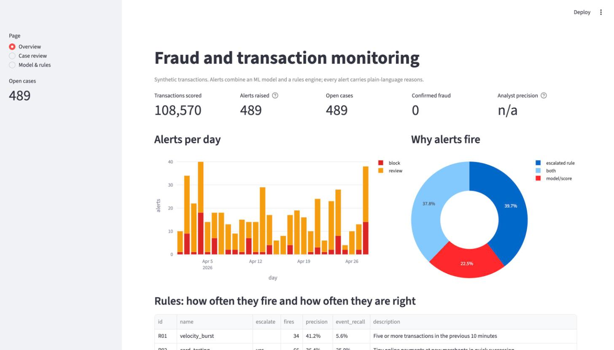
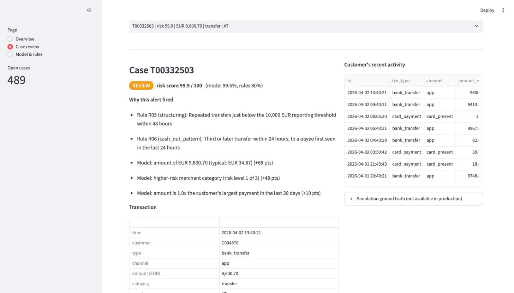
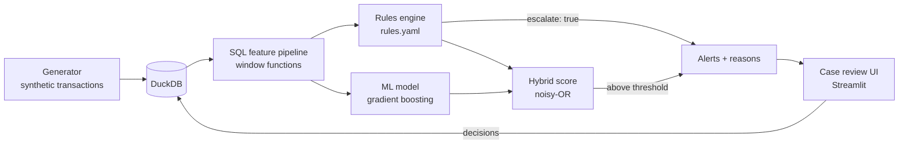
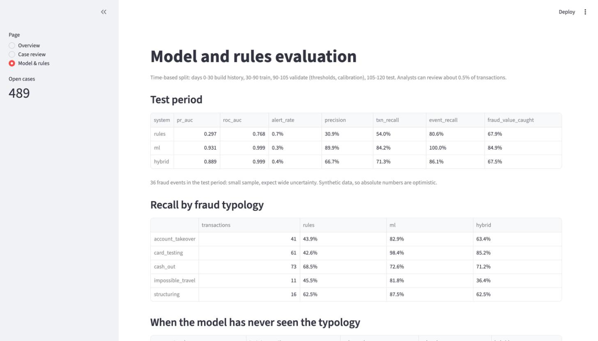

# Fraudwatch: fraud and transaction monitoring

[](https://github.com/Rodriguez7/fraud-monitoring/actions/workflows/ci.yml)

A small but complete fraud-monitoring system: a **SQL feature pipeline** (DuckDB), a **rules engine** analysts can edit, an **ML model**, **alerts that explain themselves in plain language**, and a **case-review screen** where an analyst confirms fraud or marks false positives.

It runs end to end in about 15 seconds on a laptop and covers the work behind transaction monitoring at a payments company or bank: feature engineering without leakage, rules plus ML, review-capacity thinking, explainability and an honest evaluation.





## What it does

1. **Generates** 436,000 synthetic card payments and bank transfers for 5,000 customers over 120 days, with five fraud typologies and plenty of legitimate behaviour that looks like fraud.
2. **Builds features in SQL** (window functions over each customer's history: velocity, new device, new payee, impossible travel, amount anomaly, near-threshold transfers).
3. **Scores every transaction twice**: with declarative rules (`rules.yaml`) and with a gradient-boosting model, then combines them.
4. **Opens a case** for each alert, with reasons such as *"Rule R05 (structuring): repeated transfers just below the 10,000 EUR reporting threshold"* and *"Model: device first seen for this customer in the last 24 hours (+99 pts)"*.
5. **Lets an analyst decide** in a Streamlit app. Decisions are stored with the analyst's name and note, and feed an analyst-precision KPI.



## Quick start

```bash
git clone https://github.com/Rodriguez7/fraud-monitoring.git
cd fraud-monitoring
make install        # creates .venv and installs the package
make run            # generate data, SQL features, train, score  (~15 s)
make experiments    # optional: the unseen-typology experiment    (~20 s)
make dashboard      # opens http://localhost:8501
make test           # 48 tests
```

No accounts, API keys or downloads are needed. Everything is generated locally from a fixed seed.

## The data, and why it is synthetic

Real payment data is confidential. The public alternatives were not a good fit: PaySim needs a Kaggle login and has few columns (it is benchmarked separately below), and the ULB credit-card set has anonymised features, so nothing in an alert can be explained to a human. This repository generates its own data with a fixed seed instead (`src/fraudwatch/generate.py`).

Two design choices keep it from being trivially solvable:

- **Legitimate look-alikes.** Customers travel, replace their phone, buy a phone abroad, make one-off large purchases, go on shopping sprees, top up app stores with bursts of micro-payments, pay several new payees on moving day, shop across the border, and make two large property transfers. Each of these trips a single rule.
- **Mild fraud.** Half of the fraud events use smaller amounts or a known device, so no single signal catches everything.

| Typology | What it looks like |
|---|---|
| `account_takeover` | New device and country, high-value electronics, gift cards or crypto |
| `card_testing` | Many tiny online payments at new merchants within minutes |
| `cash_out` | Several transfers to new payees within hours |
| `structuring` | Repeated transfers just below the 10,000 EUR reporting threshold |
| `impossible_travel` | Card-present payments in two distant countries within the hour |

The typology label is used only for analysis. It is never a model feature, and device and payee identifiers are generated so they carry no hint of the label.

## SQL feature pipeline

`src/fraudwatch/sql/features.sql` computes 30 features per transaction with DuckDB window functions. Every window looks strictly backward (`EXCLUDE CURRENT ROW`, never `FOLLOWING`), and `(customer, timestamp)` is unique so same-instant rows can never leak in. A test appends rows seconds *after* a transaction and checks its features do not change; I also broke the SQL on purpose to confirm that test fails.

Examples: transactions in the previous 10 minutes, hour and day; amount against the customer's 30-day mean and spread; device, payee and country first seen in the last 24 hours; country change within two hours of the previous card payment; transfers just below 10,000 EUR in the last 48 hours.

## Rules engine

Rules live in [`rules.yaml`](src/fraudwatch/rules.yaml), so an analyst can read and change them without touching Python. There is no `eval`: conditions are structured data evaluated as vectorised comparisons.

```yaml
- id: R03
  name: account_takeover_signature
  description: High-value risky purchase abroad from a device first seen in the last 24 hours
  weight: 0.70
  escalate: true
  all:
    - {feature: is_new_device, op: "==", value: 1}
    - {feature: is_cross_border, op: "==", value: 1}
    - {feature: amount_eur, op: ">=", value: 300}
    - {feature: category_risk, op: ">=", value: 2}
```

Weights from several fired rules combine with noisy-OR, so independent evidence adds up but never exceeds 1. Rules marked `escalate: true` are trusted enough to open a case on their own. Noisy rules (velocity, impossible travel, amount anomaly) only raise the score. The dashboard shows each rule's measured precision, so weights and escalation can be tuned from evidence.

## Model

A gradient-boosting classifier (scikit-learn `HistGradientBoostingClassifier`) on the SQL features, calibrated with a sigmoid on a separate validation period.

- **Time-based split, never random:** days 0 to 30 build history only, 30 to 90 train, 90 to 105 validate (calibration and alert thresholds), 105 to 120 test. The test period is not touched until the final evaluation.
- **A review budget, not a probability cut-off.** Analysts can review about 0.5% of transactions. The alert threshold is set on the validation period to fit that budget, then applied unchanged to the test period.
- **Alerts:** a transaction alerts if its hybrid score clears the threshold, or if an escalated rule fires. Escalated alerts use part of the budget first.

## Explanations

Each alert lists the rules that fired and the top model drivers. Drivers come from **occlusion**: each feature is replaced with its training median, one at a time, and the drop in predicted probability is that feature's contribution. It is model-agnostic and easy to reason about. The limitation is that correlated features (such as the 10-minute and 1-hour counts) share credit, so I use it as a reading aid for analysts, not as a formal attribution method.

## Results

Held-out test period: 54,149 transactions, 36 fraud events, a fraud rate of 0.37%.

| System | PR-AUC | Alert rate | Precision | Txn recall | Event recall | Fraud value caught |
|---|---|---|---|---|---|---|
| Rules only | 0.297 | 0.65% | 31% | 54% | 81% | 68% |
| ML only | 0.931 | 0.35% | 90% | 84% | 100% | 85% |
| **Hybrid (rules + ML)** | 0.889 | 0.40% | 67% | 71% | 86% | 68% |

*Event recall = share of fraud events with at least one alert. PR-AUC is more informative than ROC-AUC at this class balance (both ML systems have ROC-AUC 0.999).*

### How to read this honestly

- **The ML model beats the hybrid on this data.** I wrote the generator, so the model learns the patterns I put in. Absolute numbers are optimistic and should not be compared with real-world systems. Compare the systems with each other.
- **Only 36 fraud events** are in the test period, so expect wide uncertainty and a point or two of variation between runs.
- **Why keep the rules then?** They are insurance against fraud the model has never seen. In a second experiment, the model is retrained with one typology removed entirely, and each system is asked to catch it in the test period:

| Typology unseen in training | Rules only | ML only | Hybrid |
|---|---|---|---|
| card_testing | 43% | **3%** | 41% |
| cash_out | 68% | **25%** | 66% |
| structuring | 62% | **0%** | 50% |
| account_takeover | 44% | 46% | 44% |
| impossible_travel | 45% | **0%** | **0%** |

The hybrid recovers most of what the rules catch, and the model alone misses almost all of it. The cost is the precision drop in the first table. That is the trade: **accept somewhat more false positives to stay covered when a new fraud pattern appears.** `impossible_travel` stays at 0% because R04 has only 25% precision, so I deliberately did not let it escalate on its own.



## Benchmark on the public PaySim data set

The main project uses synthetic data I generated, so I also ran the same approach on a well-known public one: **PaySim** (Lopez-Rojas, Elmir and Axelsson, 2016; [Kaggle](https://www.kaggle.com/datasets/ealaxi/paysim1), CC BY-SA 4.0), 6.36 million mobile-money transactions. The file is about 470 MB and needs a Kaggle login, so it is not in this repository:

```bash
# download archive.zip from Kaggle, unzip it, then:
make paysim CSV=path/to/PS_20174392719_1491204439457_log.csv     # about 15 s
```

Same discipline as the main project: SQL features with strictly backward windows, a time-based split (train 70%, validate 15%, test 15% of rows) and a 0.5% review budget. PaySim has almost no customer history (nearly every origin account appears once), so look-back features are built on the *destination* account, where fraudulent "mule" accounts receive many transfers.

| System (test period, 918,617 transactions, 4,006 fraud) | PR-AUC | Alert rate | Precision | Recall | Fraud value caught |
|---|---|---|---|---|---|
| Dataset's own `isFlaggedFraud` rule | n/a | 0.00% | 100% | 0.3% | 1% |
| Rule: transfer or cash-out that empties the account | n/a | 19.1% | 2% | 97% | 84% |
| ML, behavioural features only (12 features) | 0.482 | 0.50% | 43% | 50% | 84% |
| ML, plus balance features (18 features) | **1.000** | 0.50% | 87% | 100% | 100% |

**What this shows.** A perfect PR-AUC is not a success story; it is a warning. PaySim fraud always empties the origin account, so the balance columns hand the model the answer. Without them, the same model scores 0.48, which is a much more honest picture of how hard the behavioural problem is. The dataset's own rule flags almost nothing, and the obvious analyst rule flags 19% of all traffic at 2% precision, which no review team could work. Results on this data set should be read with that in mind, and I would not quote the 1.000 in an interview without saying so.

The test period also has a fraud rate of 0.44% against 0.08% in training, because PaySim's late steps contain far fewer legitimate transactions. That drift is a good reminder of why thresholds are chosen on a validation period and then monitored.

## Design decisions

| Decision | Why |
|---|---|
| DuckDB and SQL for features | Features are the part banks actually maintain, and window functions make look-back logic explicit and testable. No server to run. |
| Rules in YAML, not code | Analysts own rules. A change is a reviewable diff, not a deployment. |
| Noisy-OR combination | Simple, monotone and explainable: more evidence never lowers the score. |
| Time-based split and a review budget | Random splits leak the future. Analyst capacity is the real constraint in production. |
| Occlusion explanations | Every alert needs reasons a human can read. Adverse decisions need to be explainable. |
| Synthetic data with look-alikes | Keeps the repo self-contained and honest about what the numbers mean. |

## Before this could go to production

- **Online scoring:** features are computed in batch here. Real authorisation needs the same features from a low-latency store.
- **Feedback loop:** analyst decisions are stored but not yet used to retrain the model or retune rule weights.
- **Drift monitoring:** alert rate, score distribution and per-rule precision should be tracked over time.
- **Label delay:** real fraud labels arrive days or weeks late (chargebacks), which changes how training and evaluation must work.
- **Governance:** model documentation, rule change approval, audit trail, and data-protection review (GDPR, PSD2 strong customer authentication context).
- **More signals:** graph features (shared devices and payees across customers), merchant risk and device fingerprinting.

## Repository layout

```
src/fraudwatch/
  generate.py      synthetic customers and transactions, fraud typologies, look-alikes
  sql/features.sql the feature pipeline (DuckDB window functions)
  rules.yaml       detection rules
  rules.py         rules engine
  model.py         training, calibration, time-based evaluation
  scoring.py       hybrid score and plain-language explanations
  cases.py         case queue and decisions
  pipeline.py      generate -> features -> train -> score
  experiments.py   unseen-typology experiment
  paysim.py        benchmark on the public PaySim data set
  sql/paysim_features.sql  PaySim feature pipeline
  cli.py           `fraudwatch run | dashboard | ...`
app/dashboard.py   Streamlit dashboard and case review
tests/             48 tests (features, rules, scoring, generator, PaySim, end to end)
```

## Tests and CI

`make test` runs 48 tests, including look-ahead checks on the SQL features, rule-engine edge cases, review-budget logic and an end-to-end run on a small simulation. GitHub Actions runs lint, tests and a smoke run on every push.

## Licence

MIT for the code. The generated data is synthetic and contains no personal information. PaySim is a third-party data set under CC BY-SA 4.0; it is downloaded by the user and never redistributed here.
